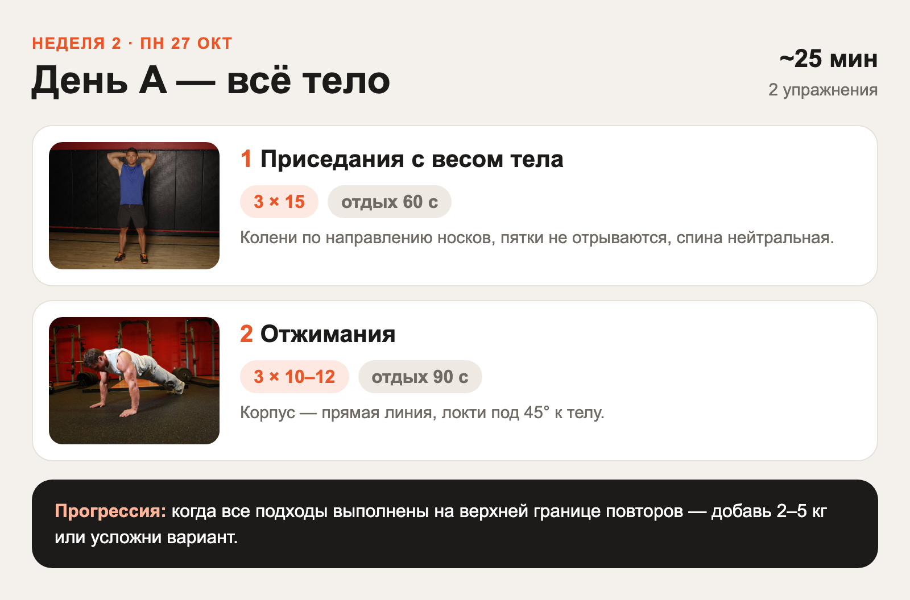
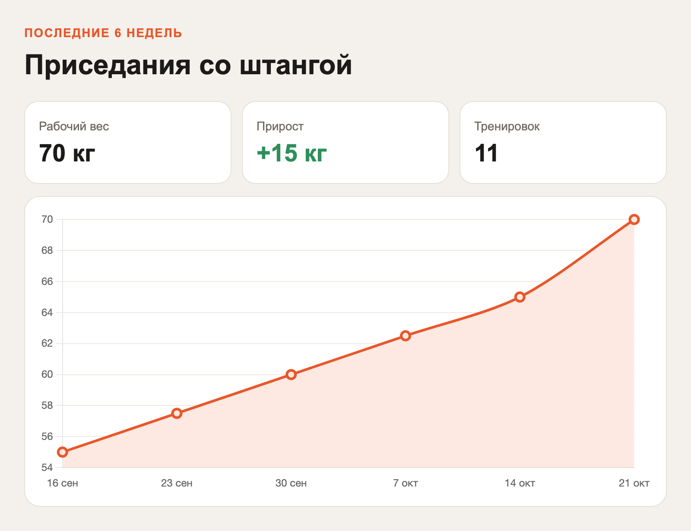

# claude-trainer-bot

Персональный тренер в Telegram. Внутри — [Claude Agent SDK](https://github.com/anthropics/claude-agent-sdk-python)
(движок Claude Code как библиотека), который живёт в своей папке на сервере, ведёт ваш план и журнал
тренировок в Markdown-файлах и присылает в чат картинки: фото техники упражнений и карточки
тренировок, отрендеренные из HTML.

```
Telegram ──► aiogram ──► ClaudeSDKClient (сессия на чат, resume между рестартами)
                              │  cwd = ~/trainer
                              │  ├─ CLAUDE.md   роль тренера и правила
                              │  ├─ profile.md  цели, здоровье, инвентарь
                              │  ├─ plan.md     программа
                              │  ├─ log.md      журнал
                              │  ├─ exercises-db/  ~870 упражнений с фото
                              │  └─ out/        HTML-артефакты → PNG
                              │
                              └─ MCP-инструменты бота: send_artifact, send_exercise,
                                 search_exercises, send_photo, send_file
```

## Возможности

- Обычный чат с Claude: «составь план на 3 дня в неделю дома с гантелями», «сделал 3×10 по 20 кг».
- `/new` (или `/clear`) — новая беседа, как `/clear` в Claude Code. Память тренера в файлах не теряется.
- `/stop` — прервать ответ, `/status` — id сессии и стоимость.
- **Артефакты**: Claude пишет HTML (карточка дня, план недели, график прогресса на Chart.js),
  бот рендерит его в headless Chromium и присылает PNG. Длинные страницы уходят файлом.
- **Фото упражнений** из [free-exercise-db](https://github.com/yuhonas/free-exercise-db)
  (Unlicense): Claude ищет упражнение и отправляет 2 кадра техники с русской подписью.
- **Входящие фото и файлы** сохраняются в `inbox/`, Claude их смотрит (еда, техника, весы).
- **Напоминания**: утром — план на день, вечером — «как прошла тренировка?», если в журнале пусто.
- Доступ только для id из `TELEGRAM_ALLOWED_USERS`.

| Карточка тренировки | График прогресса |
|---|---|
|  |  |

## Быстрый старт

### 1. Что понадобится

- Токен бота от [@BotFather](https://t.me/BotFather).
- Ваш Telegram id — например, у [@userinfobot](https://t.me/userinfobot).
- Доступ к Claude, один из двух:
  - `ANTHROPIC_API_KEY` с [console.anthropic.com](https://console.anthropic.com) — оплата за токены;
  - `CLAUDE_CODE_OAUTH_TOKEN` — токен подписки Pro/Max, выдаёт `claude setup-token`
    (запустить на любой машине, где есть Claude Code и браузер).

Устанавливать Claude Code на сервер не нужно: CLI вшит в пакет `claude-agent-sdk`.

### 2а. Docker (проще всего)

```bash
git clone <этот репозиторий> && cd claude-trainer-bot
cp .env.example .env && nano .env
mkdir -p data/trainer data/claude && sudo chown -R 1000:1000 data
docker compose up -d --build
docker compose logs -f
```

Папка тренера — `./data/trainer`, файлы можно читать и править руками.

### 2б. Без Docker (отдельный пользователь + systemd)

Пошагово, с проверками и эксплуатацией — [docs/DEPLOY.md](docs/DEPLOY.md). Коротко:

```bash
sudo adduser --disabled-password trainer
sudo apt-get install -y python3-venv git fonts-noto-core fonts-noto-color-emoji
sudo -iu trainer sh -c 'git clone <этот репозиторий> && cd claude-trainer-bot && ./scripts/install.sh'
sudo /home/trainer/claude-trainer-bot/.venv/bin/playwright install-deps chromium
sudo -iu trainer nano claude-trainer-bot/.env
sudo cp /home/trainer/claude-trainer-bot/deploy/trainer-bot.service /etc/systemd/system/
sudo systemctl daemon-reload && sudo systemctl enable --now trainer-bot
```

### 3. Первое сообщение

Напишите боту «привет». Тренер начнёт знакомство, заполнит `profile.md` и предложит план.

## Настройки (`.env`)

| Переменная | По умолчанию | |
|---|---|---|
| `TELEGRAM_BOT_TOKEN` | — | обязательно |
| `TELEGRAM_ALLOWED_USERS` | — | id через запятую; первый получает напоминания |
| `ANTHROPIC_API_KEY` / `CLAUDE_CODE_OAUTH_TOKEN` | — | одно из двух |
| `CLAUDE_MODEL` | модель Claude Code по умолчанию | например `claude-sonnet-5-5` |
| `CLAUDE_MAX_BUDGET_USD` | без лимита | потолок стоимости одного хода |
| `CLAUDE_ALLOW_BASH` | `true` | разрешить shell-команды в рабочей папке |
| `TRAINER_WORKSPACE` | `~/trainer` | память тренера |
| `TRAINER_TIMEZONE` | `Europe/Moscow` | для напоминаний |
| `MORNING_REMINDER` / `EVENING_CHECKIN` | `08:00` / `21:00` | пусто — выключить |
| `RENDER_WIDTH` | `800` | ширина артефактов в px |

## Как это устроено

- **Сессии.** На каждый чат держится один `ClaudeSDKClient`. После каждого хода `session_id`
  сохраняется в `~/trainer/.bot/sessions.json`, поэтому после рестарта бота беседа продолжается
  (`resume`). `/new` удаляет id, и следующая реплика начинает чистую сессию. Историю сессий хранит
  сам Claude Code в `~/.claude/projects/`: в Docker это отдельный volume.
- **Память** — Markdown-файлы рабочей папки. Правила их ведения — в `CLAUDE.md`, он подхватывается
  через `setting_sources=["project"]`. Тренера настраивают правкой `~/trainer/CLAUDE.md`;
  шаблон из репозитория копируется только при первом запуске и ваши правки не затирает.
- **Права.** `permission_mode="dontAsk"`: Claude может только то, что перечислено в `allowed_tools`
  (файлы, веб-поиск, Bash, инструменты бота), остальное отклоняется без вопросов.
  Инструменты бота не выпускают пути за пределы рабочей папки.
- **Артефакты.** `send_artifact` открывает HTML в Chromium (Playwright) с `device_scale_factor=2`,
  снимает full-page скриншот и шлёт `sendPhoto`. Если картинка не влезает в лимиты Telegram
  (сумма сторон больше 10 000 px), шлёт `sendDocument`, чтобы не потерять читаемость.

## Разработка

```bash
python3 -m venv .venv && .venv/bin/pip install -e '.[dev]'
.venv/bin/pytest
```

Структура:

```
trainer_bot/
  main.py           aiogram: команды, текст, фото, файлы, запуск
  agent.py          сессии Claude по чатам, /new, /stop
  tools.py          MCP-инструменты (send_artifact, send_exercise, ...)
  render.py         HTML → PNG
  exercises.py      поиск по free-exercise-db
  scheduler.py      утренние и вечерние напоминания
  telegram_text.py  Markdown → Telegram, разбиение длинных сообщений
  workspace_template/  CLAUDE.md тренера, шаблоны файлов и артефактов
```

## Безопасность

- Бот отвечает только пользователям из allowlist. Остальным он сообщает их id и больше ничего не делает.
- Claude выполняет shell-команды (`CLAUDE_ALLOW_BASH=true`) от пользователя бота. Запускайте бот
  от отдельного пользователя или в Docker и не кладите в его домашнюю папку ничего лишнего.
  Если shell не нужен, выставьте `false`.
- `.env` с токенами в git не попадает (`.gitignore`).

## Лицензия

MIT. База упражнений free-exercise-db — Unlicense (public domain).
